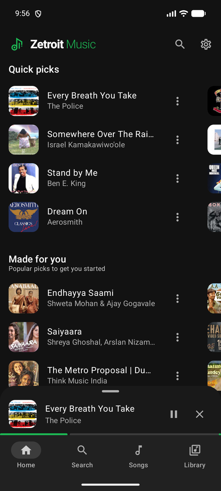
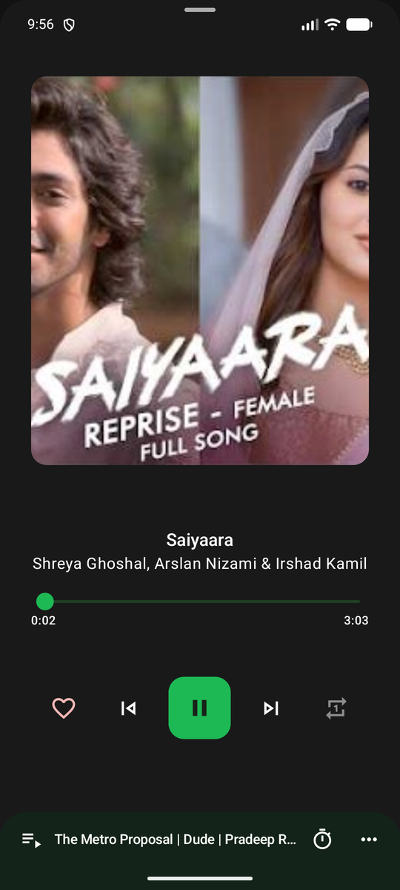
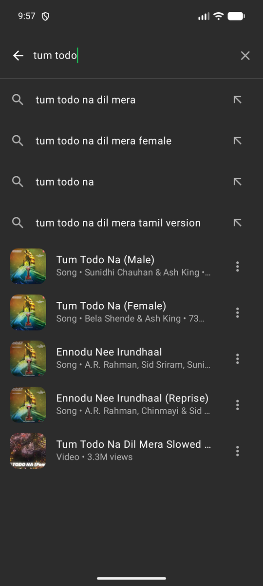
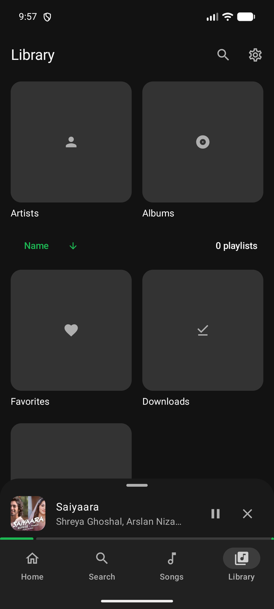
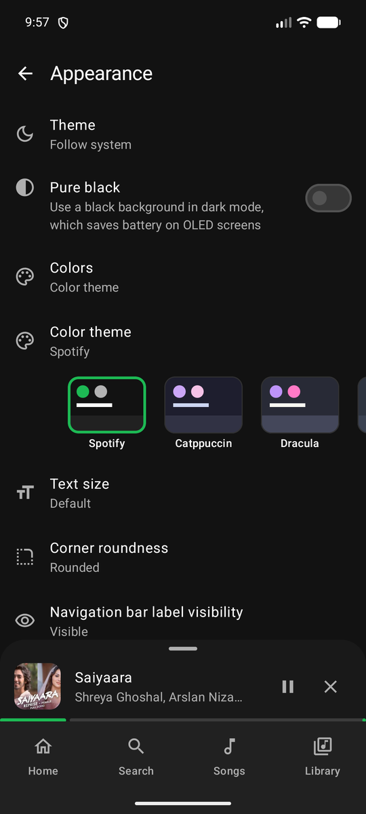

<div align="center">
    
    <h1>Zetroit Music</h1>
    <p>A free and open-source Android music player for YouTube Music.</p>
    <a href="https://github.com/ravinder9280/zetroit_music/releases/latest"><b>⬇️ Download the latest release</b></a>
</div>

## ✨ Features

- **Home made for you:** Quick picks, Recently played, Made for you, Trending in India, New releases and Browse by mood & activity
- **Search** with suggestions and top results as you type
- **Library** with your playlists, favorites, downloads, artists and albums
- **Downloads** to play songs offline, kept until you remove them
- **Appearance:** a Spotify-style default theme, Catppuccin, Dracula, Nord, Tokyo Night and Rosé Pine presets, or your own colors, plus text size, corners, progress bar and play/pause button options
- Background playback, sleep timer, persistent queue, lyrics and synchronized lyrics
- Skip silence, loudness normalization and Android Auto support
- No ads, no account and no tracking

## 📸 Screenshots

<div>
    
    
    
    
    
</div>

## 📲 Installation

1. Download `ZetroitMusic-vX.Y.Z.apk` from the [latest release](https://github.com/ravinder9280/zetroit_music/releases/latest).
2. Open it on your phone. You may need to allow "Install unknown apps" for your browser or file manager.

Requires Android 7.0 or newer.

## 🌐 Languages

English, German, Spanish, French, Italian, Russian and Turkish.

## 🛠️ Building

Requires JDK 17 or newer and the Android SDK.

```bash
./gradlew assembleDebug      # debug build
./gradlew assembleRelease    # release build
```

Release builds are signed when the `zetroitKeystoreProperties` Gradle property points to a
`keystore.properties` file with `storeFile`, `storePassword`, `keyAlias` and `keyPassword`.

## 📄 License

Zetroit Music is licensed under the [GNU General Public License v3.0](LICENSE).

It is based on [Music You](https://github.com/DanielSevillano/music-you) by Daniel Sevillano,
also licensed under GPL-3.0.

Zetroit Music is not affiliated with YouTube or Google.
